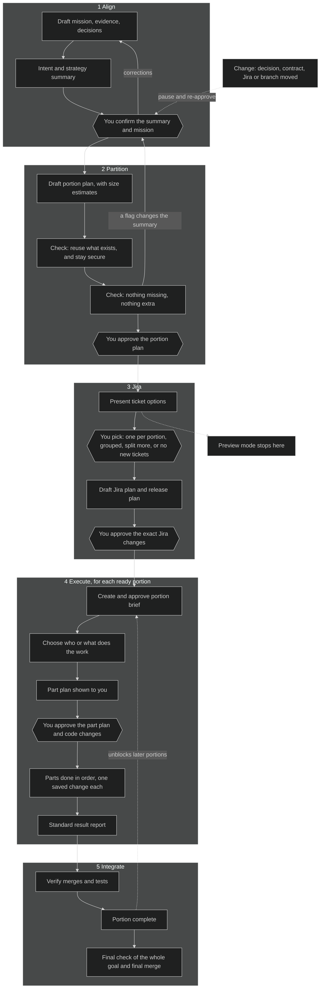

# DAC: An Introduction

DAC stands for **Divide and Conquer**. It is a way of taking a big piece of work, such as a large feature or project, and breaking it into smaller pieces that people and AI assistants can each handle without having to understand the whole thing at once. You stay in charge throughout: DAC proposes, and you approve.

## The problem it solves

Large pieces of work go wrong in familiar ways:

- Nobody holds the whole picture, so people work from different assumptions.
- The work is split in ways that look neat but don't match how it will actually be built and released.
- New things get built when something suitable already existed.
- Tickets, plans and code drift apart, and it is hard to tell what is really done.
- When work is interrupted, picking it up again means starting over.

## What DAC does

DAC keeps the shared picture in one place and hands out small, well-defined pieces of work. It does this in a fixed order, and it stops to ask you at the points that matter.

1. **Align.** It reads the Jira ticket (typically an epic or large story) and looks at the existing system, then tells you in a few lines what it thinks the goal is, what is *out* of scope, and which existing approaches it expects to reuse. You confirm or correct this *before* anything is split up. Catching a misunderstanding here is far cheaper than catching it later.
2. **Partition.** It divides the work into **portions**, each of which can be built, tested and released on its own, and each of which will become one pull request. It checks that nothing is being built that already exists, that nothing goes beyond what you asked for, and that every part of the goal is covered. You approve the partioning into portions.
3. **Jira.** It shows you options for how the portions should appear as Jira tickets: one each, grouped, split further, or none at all. You choose. Nothing is created in Jira until you approve the exact tickets. Tickets reference the dac structure and contain acceptance criteria: additional attributes are inherited from the parent ticket and all are cross-referenced.
4. **Execute.** When a portion is ready, it is divided again into short, ordered **parts**, usually one saved change each. You see the part plan first for approval. Each part is handed to whoever or whatever does the work (a person, an AI assistant or a specialist tool), with only the information that part needs, which limits cognitive load for both humans and agents.
5. **Integrate.** DAC checks that each finished portion was really merged where it was meant to be, then checks that the whole goal has been met.

## How the work is divided

| Level | What it is | How it is split |
|---|---|---|
| **Mission** | The overall goal, tied to one Jira ticket | n/a |
| **Portion** | A self-contained, releasable slice (one pull request) | By dependency and the order things must be released |
| **Part** | One focused step inside a portion, usually one commit | By workload and responsibility |

Only portions can become Jira tickets. Parts are working detail and stay out of Jira.

## The flow, and where you decide

Each hexagon is a point where DAC stops and waits for you.

## What DAC will not do on its own

DAC starts out read-only. It asks before each kind of change, and approval of a plan is never taken as approval to act on it.

| It asks before... | Examples |
|---|---|
| Writing its own working files | Creating the plan documents for a workstream |
| Running tests or builds | Checking that work behaves as expected |
| Changing code or Git | Editing source files, creating branches, committing |
| Changing anything remote | Creating Jira tickets, pushing code, opening or merging pull requests |

## What you get

- **A clear, readable record.** Each workstream has a folder of plain documents covering the goal, evidence, decisions, plan, Jira proposal, and results. Anyone can read them.
- **Easy resumption.** Everything needed to pick up after an interruption is written down, with a recorded next step.
- **Jira stays the management view.** DAC doesn't replace it. It keeps the detailed coordination on the side and updates Jira only when you approve.
- **Smaller, cheaper hand-offs.** Each part gets only the context it needs, which keeps people and AI assistants focused and saves effort.
- **Easier reviews.** Small pieces, each with a stated purpose, are quicker to check than one large change.

## Preview mode

If you want to see the plan without committing to anything, ask for a **preview**. DAC works through Align and Partition and proposes how the Jira tickets could look. It writes only its own planning documents. It stops before creating tickets, changing code or touching anything remote. You can review it and then continue later.

## When to use it, and when not to

**Good fit:** a large feature or project, work that spans several areas (database, back end, front end), or work where several people or AI assistants will share the load.

**Probably overkill:** a small, clear change that one person can do in one sitting.

## Words you may meet

| Term | Meaning |
|---|---|
| **Workstream** | One DAC run, tied to a parent Jira ticket such as `PD-123456`. |
| **Mission** | The overall goal and how we will know it is met. |
| **Portion** (`P-001`) | A self-contained slice of the work that becomes one pull request. |
| **Part** (`P-001-a`) | One ordered step inside a portion, usually one commit. |
| **Executor** | Whoever or whatever does the work: a person, an AI assistant, or a specialist tool. |
| **Drift** | The situation changing after approval, such as a changed decision or ticket, which triggers a pause. |
| **Pull request (PR)** | A proposed code change, reviewed before it is merged. |

## Getting started

Starting:
- Run `/dac` with the parent Jira ticket, or 
- Run `/dac preview` to plan without side effects.

Resuming:
- open the git branch that holds your project
- Run `/dac` to reviews tatus and next steps

Information:
- Type `/dac ?` for quick help, or `/dac-help` for guidance on whichever step you are on.
